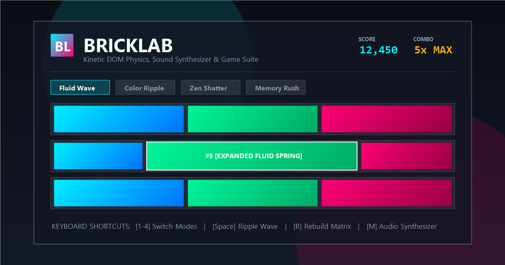

# 🧪 BrickLab

> **Kinetic DOM Physics, Procedural Sound Synthesizer & Interactive Game Suite**



**BrickLab** is an interactive, browser-native playground that transforms basic DOM elements into a tactile, spring-physics matrix. Featuring procedural Web Audio synthesis, 60fps canvas particle explosions, and multiple game modes, BrickLab runs 100% offline with **zero external dependencies**.

---

## ✨ Features

- **🌊 Dynamic Spring Elasticity**: Fluid accordion animations powered by `cubic-bezier(0.34, 1.56, 0.64, 1)` spring curves.
- **🎵 Built-in Web Audio Synthesizer**: Procedural, polyphonic harmonic synthesizer playing musical pentatonic chimes, chords, and shatter sound effects directly via the browser's native `AudioContext` (no external MP3/WAV files required).
- **💥 60 FPS Canvas Particle Physics**: Hardware-accelerated particle explosion system with velocity, friction, gravity, alpha decay, and rotational physics.
- **🎨 4 Neon Theme Presets**:
  - **Cyber Neon**: Electric cyan, hot magenta, electric amber, and deep blue.
  - **Synthwave**: Sunset orange, hot pink, radiant purple, and laser yellow.
  - **Emerald Matrix**: Matrix green, mint spark, toxic lime, and teal ocean.
  - **Obsidian Gold**: Champagne gold, amber bronze, and deep obsidian slate.
- **⚡ Dynamic Grid Sizing**: Switch on the fly between `3×3`, `4×4`, and `5×5` matrices without page reload.
- **📊 Real-Time HUD Stats**: Tracks live Score, Combo multiplier (up to 10x), and total interaction counts.
- **📱 Responsive & Glassmorphic UI**: Frosted glass panels, glowing borders, ambient backlights, and mobile-friendly touch support.

---

## 🎮 Interactive Modes

BrickLab includes 4 distinct interaction modes:

| Mode | Type | Description |
| :--- | :--- | :--- |
| **🌊 Fluid Wave** | *Physics Sandbox* | Hovering over any brick dynamically expands it with spring physics while neighbors compress proportionally. Triggers coordinate-based musical chimes. |
| **🎨 Color Ripple** | *Chain Reaction* | Clicking any brick triggers a cascading concentric color wave radiating across adjacent rows and columns with staggered audio tones. |
| **💥 Zen Shatter** | *Particle Arcade* | Clicking bricks shatters them into 30+ glowing physics sparks with sound effects, awarding combo points. Clearing the entire matrix triggers an automatic celebration and rebuild. |
| **🧠 Memory Rush** | *Puzzle Mini-Game* | A Simon Says memory challenge! The matrix flashes a sequence of musical bricks. Repeat the pattern to level up and beat your high score. |

---

## ⌨️ Keyboard Shortcuts

| Shortcut | Action |
| :---: | :--- |
| <kbd>1</kbd> | Switch to **Fluid Wave** mode |
| <kbd>2</kbd> | Switch to **Color Ripple** mode |
| <kbd>3</kbd> | Switch to **Zen Shatter** mode |
| <kbd>4</kbd> | Switch to **Memory Rush** mode |
| <kbd>Space</kbd> | Shuffle color palettes with cascade wave |
| <kbd>R</kbd> | Rebuild & restore all matrix bricks |
| <kbd>M</kbd> | Toggle audio synthesizer (Mute / Unmute) |

---

## 📁 Project Structure

```
Brick-box-manipulation/
├── index.html         # Semantic structure, glassmorphic HUD, control deck & canvas
├── style.css          # Design system, CSS variables, spring physics & themes
├── script.js          # Pure Vanilla ES6+ engine (Matrix, Audio synth, Particles)
├── favicon.svg        # Scalable vector icon
├── preview.png        # High-resolution (1200x630) OpenGraph preview image
├── site.webmanifest   # Progressive Web App (PWA) manifest
├── sitemap.xml        # SEO sitemap specification
├── robots.txt         # Search crawler directives
└── README.md          # Project documentation
```

---

## 🚀 Running Locally

BrickLab is built entirely with vanilla web standards and requires no build tools or bundlers.

### Option 1: Direct File Open
Simply double-click `index.html` or drag it into any modern web browser (Chrome, Edge, Firefox, Safari).

### Option 2: Local HTTP Server (Optional)
If you prefer running a local development server:

Using **Node.js**:
```bash
npx serve .
```

Using **Python**:
```bash
python -m http.server 3000
```

Using **VS Code**:
Right-click `index.html` and select **"Open with Live Server"**.

---

## 🛠️ Tech Stack

- **HTML5**: Semantic layout, accessible controls, and layered `<canvas>` overlay.
- **Modern CSS**: CSS Custom Properties (`--variables`), Flexbox layout, Backdrop filters, and hardware-accelerated transforms.
- **Vanilla JavaScript (ES6+)**: Event delegation, state management, and zero third-party libraries.
- **Web Audio API**: Browser-native oscillator nodes, gain ramps, and harmonic frequency mapping.

